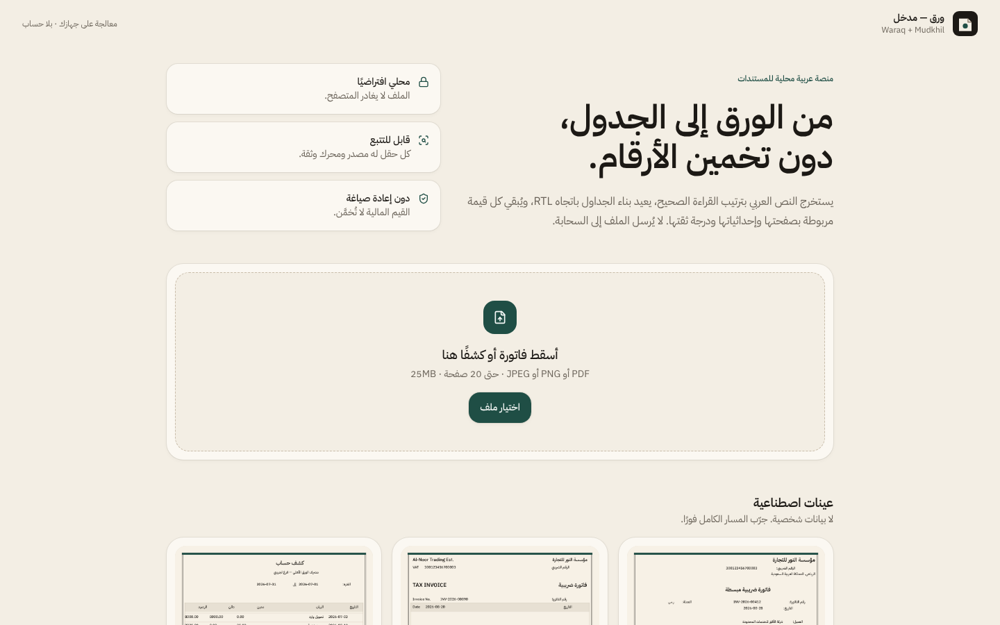

<div dir="rtl" align="center">

# 🌐 tmrsa1-ui.github.io

**الموقع الشخصي ومضيف النسخ الحية من أدوات عربية تعمل على جهازك: بلا حساب، وبلا رفع ملفاتك.**

<a href="https://tmrsa1-ui.github.io/"></a>
<br>
<a href="https://github.com/tmrsa1-ui/tmrsa1-ui.github.io/actions/workflows/ci.yml"></a>


<br><br>



</div>

<div dir="rtl">

## 🧰 الأدوات المنشورة

| الأداة | الرابط | وش تسوي |
|---|---|---|
| 📄 **ورق — مدخل** | [الرئيسية](https://tmrsa1-ui.github.io/) | تقرأ الفواتير وكشوف الحساب العربية (PDF أو صورة)، وتعيد بناء الجداول باتجاه RTL، وكل قيمة مربوطة بصفحتها وموضعها ودرجة ثقتها. المعالجة كلها في المتصفح. |
| 📍 **عنواني** | [/unwani/](https://tmrsa1-ui.github.io/unwani/) | يحلل العناوين الخليجية المكتوبة بحرية إلى حقول منظمة. [المستودع](https://github.com/tmrsa1-ui/Unwani-Web) |
| 📝 **ورقة** | [/waraqa/](https://tmrsa1-ui.github.io/waraqa/) | أداة المعلم للاختبار الورقي العربي الذي يُفتح في Word. [المستودع](https://github.com/tmrsa1-ui/Waraqa-Web) |

## ⚠️ حدود صادقة

- ما فيه أي اعتماد رسمي من جهة حكومية أو بريدية أو تعليمية.
- القيم المستخرجة تُعرض كما قُرئت، وتحتاج مراجعتك قبل الاعتماد عليها.

## 🗂️ البنية

```
index.html, assets/    ورق — مدخل (نسخة مبنية)
unwani/                عنواني
waraqa/                ورقة
tesseract/             Tesseract.js وبيانات العربية والإنجليزية (Apache-2.0، انظر NOTICE)
scripts/verify-site.mjs فحص CI قبل النشر
```

النشر تلقائي عبر GitHub Actions عند الدفع إلى `main`. راجع [`SECURITY.md`](SECURITY.md) و[`CHANGELOG.md`](CHANGELOG.md).

</div>
